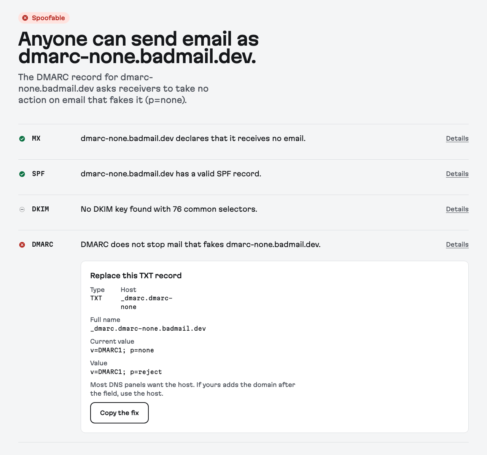

<h1 align="center">
  <picture>
    <source media="(prefers-color-scheme: dark)" srcset=".github/assets/wordmark-dark.svg">
    
  </picture>
</h1>

<p align="center">
  Postmaster of Puppets checks a domain’s MX, SPF, DKIM and DMARC records and says whether anyone can send email as it.
</p>

<p align="center">
  <a href="https://postmasterofpuppets.com/">Try it</a> |
  <a href="#use-the-engine">Use the engine</a> |
  <a href="CONTRIBUTING.md">Contribute</a>
</p>

[](https://github.com/randyesperben/postmaster-of-puppets/actions/workflows/test.yml)

<picture>
  <source media="(prefers-color-scheme: dark)" srcset=".github/assets/result-dark.png">
  
</picture>

## Try it

Check a domain at [postmasterofpuppets.com](https://postmasterofpuppets.com/). The check runs in the browser and asks public DNS-over-HTTPS resolvers, so there is nothing to install. To share a result, put the domain after a `#`: `https://postmasterofpuppets.com/#example.com`.

## What it checks

- **MX**: which servers receive mail for the domain, in which order, and which provider runs them.
- **SPF**: every include, its DNS lookups against the limit of 10, and the errors that break the record.
- **DKIM**: keys found with or without a selector, their size, and what a DNS check cannot tell.
- **DMARC**: the record tag by tag, and what it asks receivers to do with forged mail.
- **MTA-STS and TLS-RPT**: whether mail to the domain must travel encrypted, and where failures are reported.

Together they give one verdict, whether anyone can send email as the domain, and the records that fix what they find.

## Use the engine

```sh
npm install github:randyesperben/postmaster-of-puppets#v2026.11.24
```

```ts
import { parseInput, checkDomain } from "postmaster-of-puppets";

const input = parseInput("example.com");
if (!input.ok) throw new Error("Not a domain name");
const report = await checkDomain(input);
const ids = report.findings.map((f) => f.id);
console.log(report.verdict, ids);
```

`parseInput` takes a domain, a web address or an email address and keeps the domain. `checkDomain` resolves to a report: its `verdict` is `spoofable`, `partly-protected`, `protected` or `cant-tell`, and its `findings` come most serious first, each with an `id`, a `severity` and what the DNS showed. `findingText` gives a finding's title, explanation and fix in words, and `fixesAsText` every fix as one text to copy. They are the texts postmasterofpuppets.com shows, so a few of them refer to that page. `src/index.ts` exports every type. Most are in [`src/types.ts`](src/types.ts), those of a resolver and its answers in [`src/dns/types.ts`](src/dns/types.ts), and what each key of a finding's `vars` means is in [`src/finding-vars.ts`](src/finding-vars.ts).

The lookups go to public DNS-over-HTTPS resolvers over `fetch`. Pass your own `resolver` in the options to use another one, a `signal` to cancel the check, or `deadlineMs` to change its 10-second limit. `ENDPOINT_URLS` lists every address it may fetch, for the `connect-src` of a page's Content-Security-Policy.

It ships as TypeScript source with no dependencies. Bundlers that compile TypeScript, such as Vite and esbuild, import it as it is, and so does Bun. Node and Deno do not strip types inside `node_modules`, so bundle it first for them.

Its imports end in `.ts`, so type-checking it needs one option in your `tsconfig.json`, `allowImportingTsExtensions`, which TypeScript allows together with `noEmit`. With that option and a `target` of ES2020 or later, it passes `strict` on TypeScript 5.5 or later.

## Accuracy and sources

Each rule cites the RFC section or provider page it comes from, and the [About page](https://postmasterofpuppets.com/about/) lists them. [badmail.dev](https://postmasterofpuppets.com/test-domains/) is a public DNS zone of deliberately broken email setups, one name per case, so anyone can check the engine against a known answer. If the engine gets one of them wrong, that is a bug: [report it](https://github.com/randyesperben/postmaster-of-puppets/issues/new?template=wrong-verdict.yml).

[`data/email-providers.json`](data/email-providers.json) holds the provider records and DKIM selectors the engine knows, each with where it comes from: the provider's own page, or the DNS of domains that use it. Its JSON Schema is next to it.

## Contributing

Issues have forms for the common cases: an email provider that is missing or wrong, a new badmail.dev case, and a verdict that looks wrong. This repository is exported from the source of postmasterofpuppets.com, so a pull request is applied there by hand and credited to its author with a `Co-authored-by` line. See [CONTRIBUTING.md](CONTRIBUTING.md).

## License

[MIT](LICENSE), copyright (c) 2026 Randy Esperben. The name Postmaster of Puppets and its logo are not covered by the MIT License. Two files built from the [Public Suffix List](https://publicsuffix.org/), `src/data/psd-dmarc.ts` and `src/data/psl-rest.ts`, keep its Mozilla Public License 2.0, as their first line says. The provider records in `data/` are under CC BY 4.0, as [postmasterofpuppets.com/data/](https://postmasterofpuppets.com/data/) publishes them. Words quoted from provider pages, there and in the sources of each provider value, belong to those pages.

Made and maintained by [Randy Esperben](https://randy.esperben.com/).
